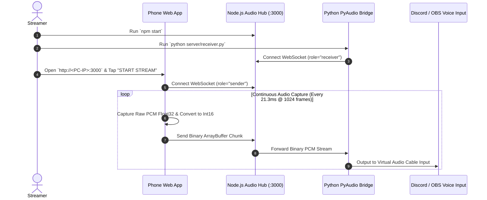

# Android to PC Microphone 🎙️⚡

<div align="center">

[](https://nodejs.org/)
[](https://developer.mozilla.org/en-US/docs/Web/API/WebSocket)
[](https://developer.mozilla.org/en-US/docs/Web/API/Web_Audio_API)
[](https://python.org/)
[](LICENSE)

**Ultra-low-latency, zero-install wireless & USB microphone audio streaming system turning Android smartphones into studio-grade PC input devices.**

[Overview](#-executive-summary) • [System Architecture](#-system-architecture) • [Key Capabilities](#-key-features--engineering-highlights) • [Getting Started](#-getting-started--quick-setup) • [Virtual Audio Cable Setup](#-virtual-audio-cable-integration-discordobs)

</div>

---

## 📖 Executive Summary

**Android to PC Microphone** turns any modern smartphone into a low-latency wireless or USB microphone for your PC without requiring proprietary mobile apps, shady third-party drivers, or Bluetooth pairing limitations.

By combining the **HTML5 Web Audio API (`getUserMedia`)** with **Binary WebSocket PCM streaming** and a **Python / Node.js Virtual Audio Cable feeder**, raw uncompressed 48kHz 16-bit audio is captured and piped directly into Discord, OBS Studio, Zoom, Google Meet, or gaming voice chats with sub-20ms latency over Wi-Fi or USB tethering.

---

## ⚡ Key Features & Engineering Highlights

| Feature | Technical Mechanism | Benefit |
| :--- | :--- | :--- |
| **🚀 Zero-Install Mobile PWA** | Web Audio API inside mobile browser | Works instantly on Android Chrome / Samsung Internet without installing APKs. |
| **⚡ Sub-20ms Latency** | Direct Int16 PCM Binary ArrayBuffer over WebSocket | Bypasses heavy encoding/decoding overhead for real-time gaming & streaming. |
| **🎚️ Live VU Meter & Gain Boost** | AudioContext AnalyserNode (FFT 256) | Real-time decibel monitoring, peak clipping detection, and software pre-amp gain. |
| **🔌 Virtual Audio Cable Feeder** | Python PyAudio / PortAudio Bridge | Routes incoming phone audio directly to Discord, OBS, or DAW virtual inputs. |
| **📱 Instant QR Pairing** | Server-side Dynamic QR Code Generation | Scan QR code on your PC monitor to immediately open the microphone client. |
| **📶 Dual Transport Support** | Wi-Fi LAN & USB Reverse Tethering | Works wirelessly over local 5GHz Wi-Fi or zero-jitter via USB cable. |

---

## 🏗️ System Architecture

```mermaid
flowchart TD
    subgraph MobileDevice["1. Android Smartphone (Web Audio PWA)"]
        MicInput["Hardware Microphone (48kHz / 16-bit)"]
        WebAudioNode["Web Audio Context (getUserMedia)"]
        GainAnalyser["GainNode Pre-Amp & AnalyserNode VU Meter"]
        PCMBuffer["ScriptProcessor / Int16Array PCM Chunking"]
        WSMobile["WebSocket Sender (Binary ArrayBuffer)"]
    end

    subgraph ServerGateway["2. Node.js WebSocket Audio Hub (:3000)"]
        ExpressHTTP["Express Server (Static Client & Dynamic QR Code)"]
        WSServer["WebSocket Audio Relay Router"]
    end

    subgraph PCDevice["3. PC Receiver & Virtual Microphone Bridge"]
        PyReceiver["Python Audio Bridge (server/receiver.py)"]
        VBVirtualCable["VB-Audio Virtual Cable / Default Output"]
        Apps["Discord / OBS Studio / Zoom / Games"]
    end

    MicInput --> WebAudioNode
    WebAudioNode --> GainAnalyser
    GainAnalyser --> PCMBuffer
    PCMBuffer --> WSMobile

    WSMobile -->|Binary PCM Streams (Wi-Fi / USB)| WSServer
    ExpressHTTP -->|Serve PWA UI| MobileDevice

    WSServer -->|Localhost WS Broadcast| PyReceiver
    PyReceiver -->|Direct Stream Write| VBVirtualCable
    VBVirtualCable --> Apps
```

---

## ⏱️ Audio Streaming Sequence



---

## 📂 Project Structure

```text
AndroidToPC-Microphone/
├── .github/                      # GitHub Issue & PR Templates
│   ├── ISSUE_TEMPLATE/           # Standardized Bug & Feature templates
│   ├── PULL_REQUEST_TEMPLATE.md  # PR Quality assurance checklist
│   ├── CODEOWNERS                # Repository Maintainer Directives
│   └── dependabot.yml            # Automated Dependency Security
│
├── client/                       # Mobile Web Audio PWA Client
│   └── index.html                # Responsive Dark UI with VU Meter & Gain Boost
│
├── docs/                         # Architecture & Documentation
│   ├── ARCHITECTURE.md           # Deep Technical Design & Buffer Sizing
│   └── DEPLOYMENT.md             # USB Tethering & LAN Routing Runbook
│
├── server/                       # Backend Audio Relay & Feeder
│   ├── server.js                 # Express HTTP + WebSocket Binary Audio Hub
│   └── receiver.py               # Python PyAudio Virtual Audio Cable Bridge
│
├── start.bat                     # Windows Batch Launcher
├── start.ps1                     # PowerShell Launcher
├── package.json                  # Dependencies & Node Scripts
└── README.md                     # Executive Documentation
```

---

## 💻 Getting Started & Quick Setup

### Prerequisites
- **Node.js** `>= 18.x`
- **Python** `>= 3.8` (for virtual cable feeder) with `pyaudio` and `websockets` installed:
  ```bash
  pip install pyaudio websockets
  ```

---

### Step 1: Start Audio Hub Server
```bash
# Clone repository
git clone https://github.com/Gubbitkeytoday/AndroidToPC-Microphone.git
cd AndroidToPC-Microphone

# Install dependencies
npm install

# Start server
npm start
```

The terminal will display your local network IP (e.g. `http://192.168.1.50:3000`).

---

### Step 2: Open Mobile Microphone Client
1. On your Android smartphone connected to the **same Wi-Fi network**, open Chrome.
2. Navigate to `http://<YOUR-PC-IP>:3000`.
3. Allow microphone permission when prompted.
4. Tap the large **TAP TO STREAM** button. The VU meter will pulse with your voice!

---

### Step 3: (Optional) Connect to Virtual Audio Cable for Discord / OBS
To pipe the phone's microphone directly into Discord or OBS as a selectable microphone device:

1. Download and install the free **[VB-Audio Virtual Cable](https://vb-audio.com/Cable/)**.
2. Run the included Python bridge:
   ```bash
   npm run receiver:py
   ```
3. In Discord / OBS / Zoom settings:
   - **Input Device (Microphone):** Select `CABLE Output (VB-Audio Virtual Cable)`.

---

## 🔒 Security & Privacy

- **100% Local LAN Traffic:** Audio is streamed directly over your private local subnet or USB cable. Zero audio packets are uploaded to the internet or third-party cloud servers.

---

## 🤝 Contributing

Contributions are welcome! Please read our **[CONTRIBUTING.md](CONTRIBUTING.md)** and **[CODE_OF_CONDUCT.md](CODE_OF_CONDUCT.md)** before submitting pull requests.

---

## 📄 License

Distributed under the **MIT License**. See [`LICENSE`](LICENSE) for complete terms.

<div align="center">
Built with ❤️ for gamers, streamers, and content creators.
</div>
